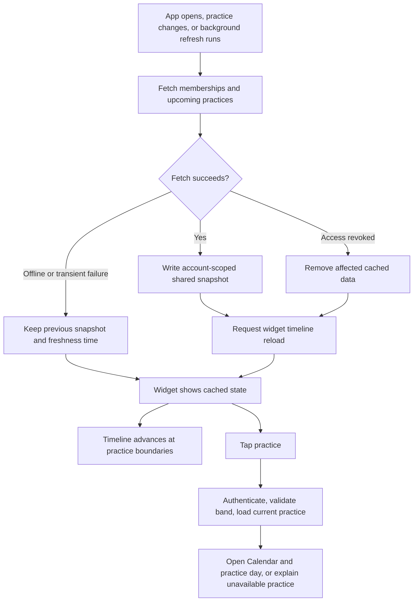

# Upcoming practices widget — investigation

Implementation and validation are tracked in [Widgets and practice location editing](../widget-and-location-review.md). The investigation below records the original findings and proposal.

September 14, 2026. Source reviewed: `2589782`. Research and implementation proposal only; no widget has been built or tested.

## Recommendation

Add a native WidgetKit extension for iPhone and iPad, starting with small, medium, and large Home Screen widgets. Keith asked to consider Large during review; include it in the first-version proposal. Show confirmed practices for a band selected in the widget's configuration. Tapping a practice should open that band's Calendar tab and the corresponding day sheet.

The app already has the necessary basic data. The main engineering work is maintaining a trustworthy shared snapshot and handling navigation when the app starts from a widget. A useful first version can use app-owned fetching and an offline cache without a database migration. Changes from other members may remain unseen until the next successful app refresh; this limitation must be explicit.

Related investigation: [practice location editing](practice-location-editing.md). The current app can display a practice's stored location but cannot edit it after scheduling. Existing Apple Calendar events also need field reconciliation before location edits can propagate correctly. A future location-edit action must publish an updated widget snapshot.

## Proposed experience

| Surface | Content |
| --- | --- |
| Small | Band name, next practice date, start–end time, location when present. |
| Medium | Next three practices, each with date and time; location as space permits. Each row opens its practice day. |
| Large | Up to six upcoming practices with dates, start–end times, and locations. Emphasize the next practice and use compact rows for the rest; each opens its practice day. Show fewer rows when larger text or long locations require more space. |
| Later: rectangular Lock Screen | Next practice date/time and a short band name. Make location optional for privacy. |

Use one configurable widget with three sizes. Default to the current band, but persist a specific band ID for each widget instance so switching bands inside the app does not unexpectedly change the widget. Offer other joined bands through an App Entity query backed by the shared band list. Apple's [configurable-widget documentation](https://developer.apple.com/documentation/widgetkit/making-a-configurable-widget) supports this through `WidgetConfigurationIntent`, `AppIntentConfiguration`, and `AppIntentTimelineProvider`.

Prefer native text, SF Symbols, semantic colors, and a restrained band accent. The [Outlook widget reference on Mobbin](https://mobbin.com/screens/25ccb821-186c-4f31-bbed-f434469e987c), visually inspected during this investigation, demonstrates a useful hierarchy: a prominent date beside compact agenda rows, reducing to one event at the small size. This matches the app's existing upcoming-practice rows. Search results also contained unrelated full-screen calendars; they were not used as widget references. Apple's [widget design guidance](https://developer.apple.com/design/human-interface-guidelines/widgets) favors focused content, legibility, and adaptation to system appearance.

Suggested states:

- No saved snapshot: “Open Band Practice to load practices.”
- Successfully refreshed, empty schedule: “No upcoming practices.”
- Practice underway: “Now,” keeping it visible until its end time.
- Old snapshot or failed refresh: retain known practices with a last-updated indication and an open-app route. A stale empty cache must not imply a newly verified empty schedule.
- Signed out: clear account data and show “Open Band Practice to sign in.”
- Band no longer accessible: clear that band's data and show “Choose a band.”

Display scheduled practices only. Availability overlaps are suggestions, and the current model has no attendance RSVP or practice notes. Avoid implying attendance confirmation from availability or member avatars.

## Repository findings

| Evidence | Implication |
| --- | --- |
| `project.yml`: iOS 26.0 minimum, universal device family; app and test targets only | WidgetKit fits the current deployment target. Add and embed an extension through XcodeGen. |
| `Models/Band.swift`: `ScheduledPractice` has ID, band ID, date, start/end minutes, and optional location | Basic content requires no new practice fields. Join the band name from membership data. |
| `Services/BandManager.swift`: `loadPractices`, schedule/cancel operations, and Realtime subscriptions | Existing successful fetches can publish widget snapshots. Realtime handling runs in the app; it is not an independent background widget service. |
| `Views/CalendarMonthView.swift`: `loadVisibleRange` overwrites `practices` with a filtered range | Do not serialize the published UI list indiscriminately. Maintain a complete upcoming snapshot independent of calendar browsing. |
| `Services/BandManager.swift`: practice data is for `currentBand` | A widget pinned to another band needs its own fetch/cache. Fetch upcoming practices for joined bands rather than only the visible band. |
| `Services/BackgroundSyncManager.swift`: reads personal calendars and writes availability; gated on calendar authorization and auto-sync | Add a separate practice-refresh path that works for manual availability and denied calendar access. The existing task does not fetch practice changes. |
| `BandManagerApp.swift`, `Info.plist`, entitlements: no widget URL route, App Group, or remote-push registration found | Add routing and shared storage. Local notifications currently generated from Realtime events are not APNs infrastructure. |
| Upcoming list filters/sorts by date alone; practice dates have no timezone field | Define deterministic start-time ordering and remove ended practices. Establish consistent date interpretation across app and widget. |

The checked-in SQL permits practice reads for band members. Live backend configuration was not queried or verified. The widget should retain the app's authenticated membership access; no privileged key belongs in a widget or shared snapshot.

## Data flow and refresh

### First version: app-owned refresh

Add a small shared model and atomic snapshot store in an [App Group container](https://developer.apple.com/documentation/xcode/configuring-app-groups). Save schema version, account identity/generation, band IDs/names, minimal practice fields, successful fetch time, and covered date range. Keep credentials and personal calendar events out of this snapshot. Use distinct Debug and Release groups, with an explicitly separate mock-data namespace.

Publish after successful schedule/cancel operations and authoritative refreshes. If a mutation succeeds but the follow-up read fails, apply the server-confirmed insertion/deletion to the cache so the user's own cancellation does not remain displayed. Preserve prior data on transient failures; invalidate it on sign-out, account change, or confirmed lost membership. Discard in-flight results belonging to an old account or band generation. Reload the widget after publishing or clearing data.

Use an independent practice fetch on foreground activation and during available background refresh opportunities. Keep this independent of EventKit permission and availability mode. Initially, the extension reads only the shared snapshot; it does not share auth tokens or start a Realtime connection.

Generate future timeline entries for date changes, practice starts/ends, and a freshness cutoff. Sort by date, start time, then ID; keep ongoing practices and exclude completed ones. Apple controls reload scheduling, so neither a requested reload nor a background task implies an exact refresh interval. Timelines can advance through known practices while offline, but cannot discover a newly cancelled practice. See [Keeping a widget up to date](https://developer.apple.com/documentation/widgetkit/keeping-a-widget-up-to-date).

Proposed initial freshness policy: after 24 hours without a successful read, label the schedule as needing refresh. Treat that as a product default to validate, not an Apple requirement or a guarantee that newer data is current. Test earlier cancellation scenarios explicitly.

### If changes must arrive while the app stays closed

Add an authenticated fetch in the widget timeline provider, with cache fallback. This requires deliberate shared credential storage and coordinated session refresh between processes, or a narrowly scoped server endpoint. Verify the pinned Supabase Swift client's storage/session behavior before implementing it. This is additional work beyond sharing display data.

iOS 26 also supports [WidgetKit push updates](https://developer.apple.com/videos/play/wwdc2025/278/). A later backend integration could send refresh signals when practices are created, changed, or cancelled. It needs token registration, membership-aware delivery, token revocation, APNs setup, and a provider that actually fetches new data. A push that only rereads an unchanged local cache would not solve freshness. Push updates are also budgeted and opportunistic; they supplement timelines rather than guaranteeing immediate delivery. See Apple's [push-update implementation guide](https://developer.apple.com/documentation/widgetkit/updating-widgets-with-widgetkit-push-notifications).

## Implementation sequence

1. **Shared data and date handling:** introduce a widget snapshot service independent of the visible calendar range. Use the existing local wall-clock semantics consistently in app and widget initially. The schema cannot establish a band's timezone; reliable travel/cross-timezone behavior needs a separate model decision. Test daylight-saving transitions, midnight, and end minute 1440.
2. **Extension and configuration:** add the WidgetKit target, shared sources, environment-specific bundle IDs/App Groups, embedded extension, small/medium/large layouts, and band configuration in `project.yml`. Register/sign the new identifiers for device and Release builds.
3. **Routing:** add a validated URL carrying band and practice IDs, with separate Debug/Release schemes. Retain the destination through authentication and asynchronous loading; select the Calendar tab, switch band, and open the current practice date. Handle cancelled/rescheduled practices and revoked membership. Use [widget links](https://developer.apple.com/documentation/widgetkit/linking-to-specific-app-scenes-from-your-widget-or-live-activity) rather than making users find the day manually.
4. **Refresh integration and review:** publish from mutation/load paths, add calendar-independent foreground/background refresh, and verify cache invalidation. Then decide whether independent extension fetching is necessary for the first release based on the freshness expectation.

This is a moderate feature touching data services, navigation, signing, and an extension. All three sizes share the same data and refresh infrastructure; Large adds layout and review work. Closed-app freshness and account isolation deserve most of the verification effort. Lock Screen, extra-large iPad layouts, and in-widget scheduling can follow separately.

## Acceptance checks for implementation

- Run `make preflight`; ensure the generated app build embeds and builds the extension.
- Add real Home Screen widgets on the saved iPhone and iPad simulators. Validate all three sizes, two bands, different configurations, Light/Dark, tinted/clear appearances, long names, and accessibility text.
- Tap links with the app running, terminated, and awaiting sign-in. Verify band, practice, and day after rescheduling or cancellation.
- Verify same-day ordering, ongoing/ended practices, stale/empty/offline snapshots, calendar-range browsing, denied calendar access, manual availability, logout, and account switching.
- Use isolated Debug fixtures and preserve external-write protections. Compare widget and app using the same clock/timezone/data; gallery previews alone do not establish correctness.
- Test background delivery and any APNs integration on a signed device. Simulator time travel or forced refreshes do not establish real-world delivery latency.

No app build, simulator installation, backend mutation, or signing change was performed for this investigation.
